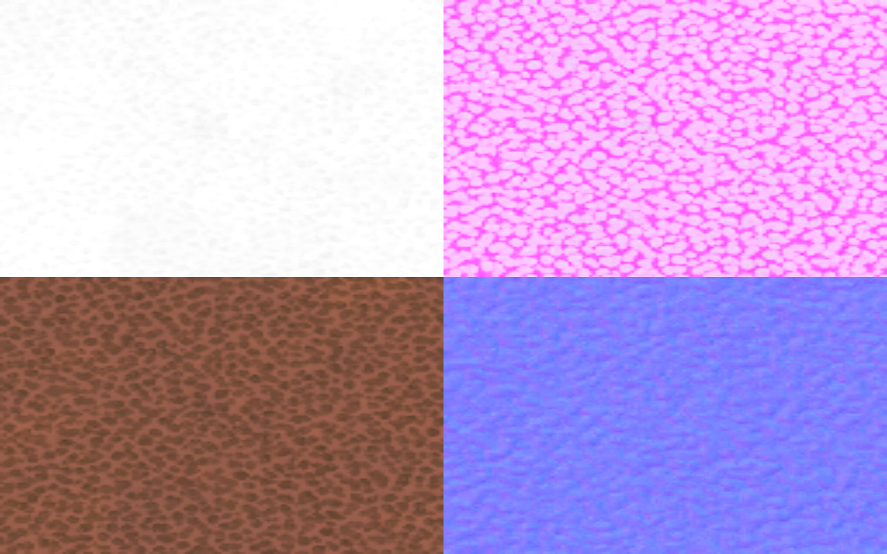
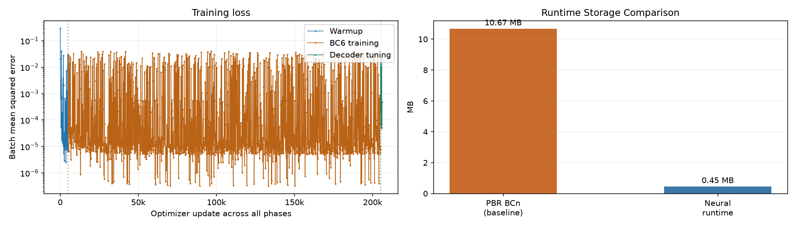

# NN-PBR

PyTorch and Vulkan implementation of [Real-Time Neural Materials using Block-Compressed Features](https://arxiv.org/abs/2311.16121). Each material has four BC6H feature textures and a 688-byte decoder. The fragment shader samples an RGB triplet from each texture and passes the 12 values through a 12 → 16 → 8 MLP to reconstruct albedo RGB, tangent-space normal XY, ambient occlusion, roughness and metallic.

## Screenshots

| Red plaid · 2048 × 2048 | Hammered copper · 512 × 512 |
| --- | --- |
|  |  |
| [Plaid model and weights](models/red-plaid-2k) | [Copper model and weights](models/hammered-copper-512) |

Both captures use the embedded HLSL decoder on a Radeon RX 9070. The top row of each capture shows AO and packed AO/roughness/metallic (ORM). The bottom row shows albedo and tangent-space normals.

## Results

| | Red plaid | Hammered copper |
| --- | ---: | ---: |
| Training updates (warmup / BC6H / decoder) | 5,000 / 200,000 / 1,000 | 500 / 5,000 / 200 |
| Training time on RX 9070 | 4 h 53 min | 2 min 22 s |
| DDS textures + FP16 weights + metadata | 471,265 bytes | 34,620 bytes |
| Albedo MSE | 0.000249 | 0.000392 |
| Normal XY MSE | 0.194 | 0.00404 |
| ORM MSE | 0.00201 | 0.00456 |

MSE is measured at full resolution from the exported DDS textures and FP16 weights. Albedo uses [0, 1]. Normal XY and ORM use [−1, 1] for training and error measurement. The reference BCn storage estimate for the 2K plaid is 11,184,864 bytes (BC1 albedo, BC5 normals, BC1 ORM, including mips).

### Red plaid

The decoder preserves the plaid checks. Fine weave detail in the normal map accounts for most of the reconstruction error.




[Loss curve (SVG)](docs/figures/red-plaid/training_loss.svg)

### Hammered copper

The short training schedule uses fused Adam. The hammered pattern is visible in the reconstruction, with softer edges on the smallest pits.


[Loss curve (SVG)](docs/figures/hammered-copper/training_loss.svg)

## Building the Vulkan demo

The viewer requires CMake, a C++17 compiler and the Vulkan SDK with `glslc`. The viewer opens the bundled 64 × 64 plaid model by default. Select another material with `--export-dir`. Windows Release build:

```sh
cmake -S . -B build
cmake --build build --config Release
build/Release/vk_neural_demo.exe --export-dir models/hammered-copper-512/export --embedded-hlsl
```

## Qt material editor (Windows)

The Qt app imports albedo, normal, AO, roughness and metallic maps. Select the maps individually or import a folder containing `albedo.png`, `normal.png`, `ao.png`, `roughness.png` and `metallic.png`. DirectX normal maps with `dx` or `directx` in the filename have their green channel flipped during preparation.

Build the Vulkan viewer as above and install the optional Qt dependency in the same Python environment as PyTorch.

```sh
python -m pip install PySide6-Essentials
python -m nnpbr.studio
```

The workspace keeps five source thumbnails beside the preset, progress bar and live loss plot. **Advanced settings** exposes feature sizes, mips, phase lengths, learning rates, batch sizes, seed, checkpoint interval and optimizer settings. Training writes to a fresh directory under `runs/studio/`.

**Open model** loads an existing export for analysis. Finishing training loads the new export automatically. Select a material channel to compare the original, decoded result and absolute error alongside all four latent textures. The source comes from the training reference when available, or from the five selected maps. The panel reports channel MSE and the maximum displayed error. Without a reference, the decoded material and latent previews remain available.

**Weights & mips** displays numeric FP16 decoder parameters and individual BC6H mip previews. **Launch Vulkan** opens the standalone viewer with the selected weights and four DDS textures. **Export package** copies the runtime assets. The File menu accepts loose BIN and DDS files. Use `--export-dir` and `--maps` to open a model and source folder from the CLI. For a custom viewer build, pass `--viewer PATH_TO_EXECUTABLE`.

The Vulkan CLI also accepts individual runtime files. Supply the 688-byte decoder blob and four unsigned BC6H DDS pyramids in feature order (0 through 3). This path uses the GLSL buffer decoder and supports files outside an export directory.

```powershell
$export = 'models/hammered-copper-512/export'
build/Release/vk_neural_demo.exe --final-view --weights "$export/decoder_fp16.bin" --latents "$export/latent_00.bc6.dds" "$export/latent_01.bc6.dds" "$export/latent_02.bc6.dds" "$export/latent_03.bc6.dds"
```

## Training

Python 3.12 with PyTorch. Install the PyTorch build for the target GPU before the project dependencies. [AMD Windows installation guide](https://rocm.docs.amd.com/en/latest/install/rocm.html?fam=radeon&gfx=gfx1201&gpu=rx-9070&i=pip&os=windows&w=graphics&windows-ver=11).

```sh
python -m pip install -r requirements.txt
python -m nnpbr smoke                       # 64 × 64 CPU test
python -m nnpbr train red-plaid-bl          # 2048 × 2048 GPU preset
python -m nnpbr check runs/red-plaid-bl/train
python -m nnpbr view models/red-plaid-2k --hlsl
```

The CPU preset uses 150 / 400 / 100 updates. The full GPU preset uses 262,144 samples per update and three phases.

1. **Warmup (5k).** Train unconstrained feature textures and the decoder.
2. **BC6H training (200k).** Fix the partition in each block. Optimize endpoints, texel indices and decoder weights.
3. **Decoder tuning (1k).** Freeze the quantized features. Tune the decoder against the texels the GPU will sample.

Other bundled inputs include `scratched-up-steel-bl` and `worn-rusted-painted-bl`. Both presets accept `--out` for a new output directory and write per-mip scores to `mip_metrics.json`. The lower-level trainer exposes microbatch size, checkpoint resume, fused Adam and the progress display through `python -m nnpbr --help`. [Illustrated BC6H and training guide](docs/tutorial.html).

### Figures

```sh
python -m nnpbr.plot runs/red-plaid-bl/train
python -m nnpbr.figures runs/red-plaid-bl/train --out docs/figures/red-plaid
```

The loss plot uses cumulative optimizer updates across all three phases. The comparison figure uses the original reference and reconstructs the material from the exported files.

## Shader integration

| File in `export/` | Contents |
| --- | --- |
| `latent_00.bc6.dds` … `latent_03.bc6.dds` | Four mipmapped, unsigned BC6H Mode 10 textures |
| `decoder_fp16.bin` | 344 FP16 weights and biases, 688 bytes |
| `metadata.json` | v5 schema, texture dimensions, mip inventory and file hashes |
| `material.hlsl` | Pixel shader include with the decoder weights embedded as constants |

Bind the textures in file order at `t1`–`t4` and a trilinear clamp sampler at `s0`. Call `DecodeNeuralMaterial(uv)` in the pixel shader. For tiled coordinates, pass UV derivatives taken before `frac()` to `DecodeNeuralMaterialWithGrad`. Convert reconstructed albedo from sRGB to linear before lighting.

```sh
python -m nnpbr.hlsl models/red-plaid-2k/export --spirv
python -m nnpbr.validate --export-dir models/red-plaid-2k/export
```

`--spirv` compiles the fragment shader for the Vulkan demo. The embedded path binds only the four latent textures. Older v4 exports require regeneration.


## Codec tests

```sh
cmake -S . -B build -DNNPBR_BUILD_CODEC_TESTS=ON
cmake --build build --config Release
python -m unittest discover -s tests -v
```

Set `BCDEC_ORACLE` to the absolute path of the built `bcdec_oracle` library before the Python tests to include the independent decoder comparison. [Codec verification and RX 9070 readback](docs/tutorial.html#fixes).
