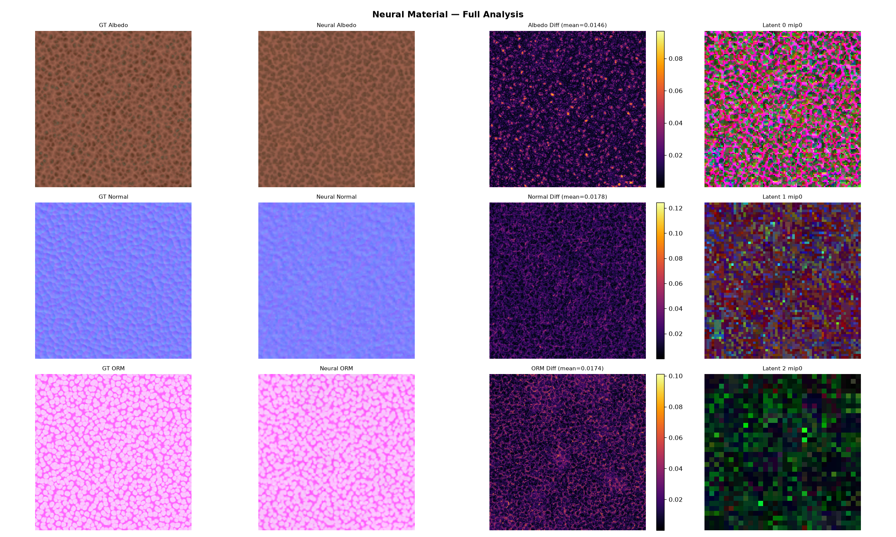
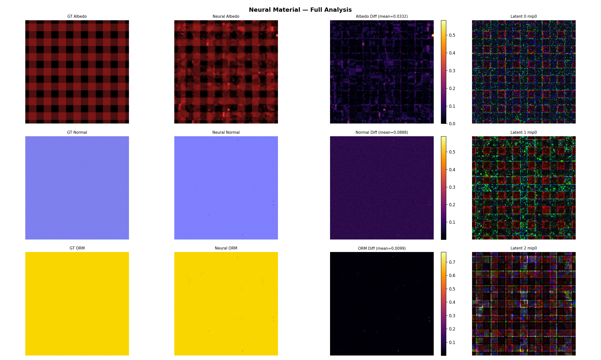
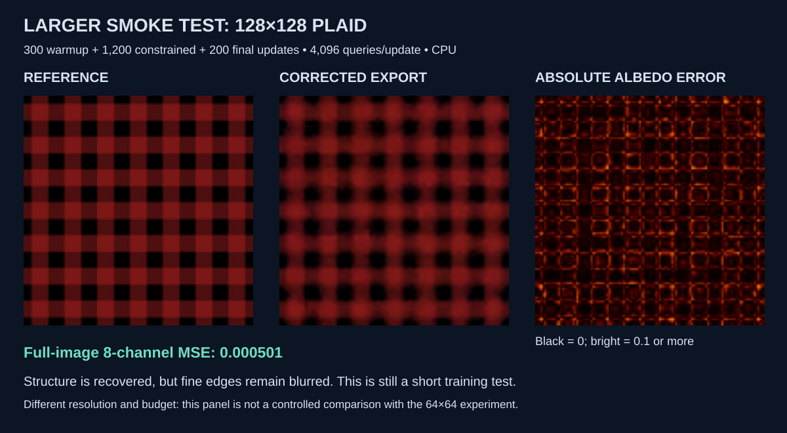

# Real-Time Neural Materials using Block-Compressed Features

> WIP implementation of [Real-Time Neural Materials using Block-Compressed Features](https://arxiv.org/abs/2311.16121).

This "bakes" one material into four small BC6H textures and a tiny decoder. In the Vulkan shader we sample all four textures, feed the 12 numbers into the decoder, and get back albedo RGB, normal XY, ambient occlusion, roughness and metallic.

## Demo

The 2K red plaid finished all 206,000 updates on the RX 9070. Here's the actual export next to the source. The checks in the albedo line up. The fine normal detail is still weak. At full resolution the albedo MSE was 0.000249 and the normal XY MSE was 0.194 (signed components).


[Open the zoomable loss curve](docs/figures/red-plaid/training_loss.svg). The runtime files total 471,265 bytes including metadata, compared with an estimated 11,184,864 bytes for the reference BCn map set. To inspect this model after building the viewer:

```sh
python -m nnpbr view models/red-plaid-2k --hlsl
```

### Hammered copper · short GPU run

This 512×512 bake took 2 minutes 22 seconds of training on the RX 9070 with fused Adam. We used 500 warmup updates, 5,000 BC6 updates and 200 decoder-tuning updates. The broad hammered pattern comes through, while the smallest pits look softer in the export.




[Zoom in on the loss curve](docs/figures/hammered-copper/training_loss.svg) or open the committed model in Vulkan:

```sh
python -m nnpbr view models/hammered-copper-512 --hlsl
```

### Original run

Here's the plaid from the original RX 9070 run. Look at the bright spots in the neural output next to the reference.



**What we got wrong.** Each 4×4 block has two groups of texels. The old trainer gave each group the other group's values. The GPU read the groups in the correct order, so the shader saw different inputs from the ones we'd trained the decoder on. Another 200k updates could still fit the wrong inputs. We could reproduce the swap in code. The weights for this screenshot are gone, so we can't trace each bright spot back to it.

[Read the illustrated tutorial](docs/tutorial.html) for a worked BC6 block, the old line of code, the fix and the comparisons. With the fixes together, error on the exported maps fell by 75.5–83.7% across four matched small runs.



## Usage

Run these commands from the repo root. Use Python 3.12 in a virtual environment. Install PyTorch for your hardware first, then the project dependencies. For the RX 9070 on Windows, use [AMD's PyTorch install guide](https://rocm.docs.amd.com/en/latest/install/rocm.html?fam=radeon&gfx=gfx1201&gpu=rx-9070&i=pip&os=windows&w=graphics&windows-ver=11).

```sh
python -m pip install -r requirements.txt
```

### 1. Try the small bake

```sh
python -m nnpbr smoke
```

This takes the bundled red plaid maps, builds a 64×64 reference, trains on CPU (150 / 400 / 100 updates), writes the runtime files and scores them against the reference at each mip. Open `runs/red-plaid-bl/smoke/mip_metrics.json` for the numbers. To try another material, append `scratched-up-steel-bl` or `worn-rusted-painted-bl`. To repeat a bake, give it a fresh directory with `--out runs/plaid-second-try`.

### 2. Open it in Vulkan

Install the Vulkan SDK with glslc, CMake and a C++17 compiler. Build the viewer once, then point it at the run you want to inspect.

```sh
cmake -S . -B build
cmake --build build --config Release
python -m nnpbr view runs/red-plaid-bl/smoke
```

For the bundled plaid, you can also launch the built vk_neural_demo executable directly. The app shows the reconstructed material maps. Escape closes it. For an existing viewer build, add `--viewer PATH_TO_EXECUTABLE`.

### 3. Bake a full material

```sh
python -m nnpbr train red-plaid-bl
```

This starts a new GPU job for a 2048×2048 reference. Warmup trains free features and the decoder for 5k updates. The next 200k train endpoints, indices and decoder with the block partitions fixed. The final 1k freeze the decoded features and tune only the decoder. The preset uses 262,144 samples per update in one GPU batch. For less GPU memory or to resume a checkpoint, use the trainer directly with the matching settings (`python -m nnpbr --help`).

The full bake writes to `runs/red-plaid-bl/train`. Both presets score the export automatically. To check it again or open it later:

```sh
python -m nnpbr check runs/red-plaid-bl/train
python -m nnpbr view runs/red-plaid-bl/train
```

Both training modes save an SVG loss plot to `analysis/training_loss.svg`. Updates run continuously across all three phases. Each dot is the loss on one logged training batch. To plot an existing run or take a snapshot while it writes `train.log`:

```sh
python -m nnpbr.plot runs/red-plaid-bl/train
```

To regenerate the README figures after a completed full bake, run the command below from the repo root. It reads the reference, decodes the exported DDS and FP16 weights again, and plots albedo, normals, packed AO/roughness/metallic, absolute errors, training loss and storage.

```sh
python -m nnpbr.figures runs/red-plaid-bl/train --out docs/figures/red-plaid
```

## What ships

Inside the run's `export/` folder you'll find four `latent_XX.bc6.dds` mip pyramids, `decoder_fp16.bin` (688 bytes) and `metadata.json` (v5). Training writes the final DDS files directly. The viewer needs only this folder. To verify the DDS files and weight fingerprints on their own, run `python -m nnpbr.validate --export-dir PATH_TO_EXPORT`. Regenerate older v4 exports with the corrected pipeline. For physical shading, convert reconstructed albedo from sRGB to linear light first.

## Embedded HLSL

Want to try it without training? Build the viewer as above and open the bundled 64×64 plaid bake:

```sh
python -m nnpbr view models/red-plaid-64 --hlsl
```

Each new bake writes `export/material.hlsl` with all 344 decoder constants. To generate it from an existing v5 export, run `python -m nnpbr.hlsl PATH_TO_EXPORT`. Add `--spirv` to compile the fragment shader for Vulkan. The viewer shortcut does both steps for you using glslc from the Vulkan SDK.

In your engine, include the generated HLSL in a pixel shader. Bind the four unsigned BC6H DDS textures to t1 through t4 in file order and a trilinear clamp sampler to s0. Call `DecodeNeuralMaterial(uv)` for the material channels. The generated file includes an example and a version that accepts explicit UV derivatives. In our Vulkan sample, `--embedded-hlsl` selects the compiled shader and skips the weight and LOD buffer uploads.


## Checking the codec

```sh
python -m unittest discover -s tests -v
cmake -S . -B build -DNNPBR_BUILD_CODEC_TESTS=ON
cmake --build build --config Release
```

Set `BCDEC_ORACLE` to the absolute path of the built `bcdec_oracle` library and rerun the tests to include the independent decoder comparison. The [tutorial's implementation review](docs/tutorial.html#fixes) covers the RX 9070 hardware readback and the training-to-export checks.
