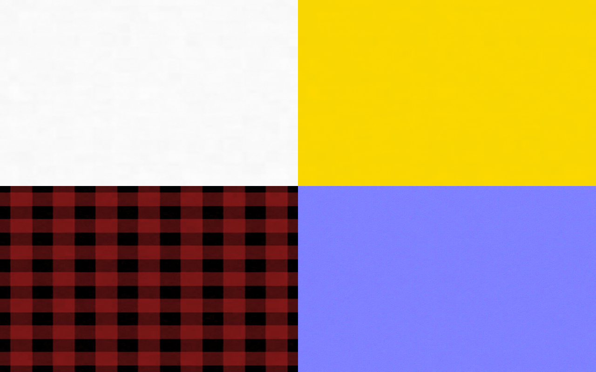
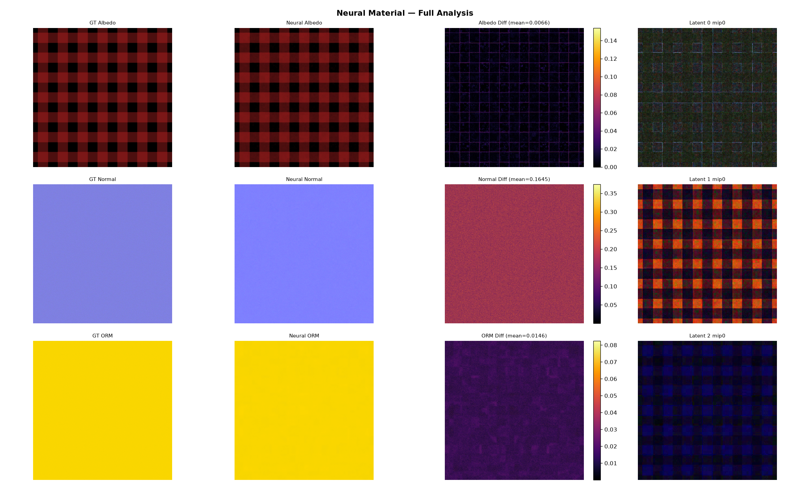
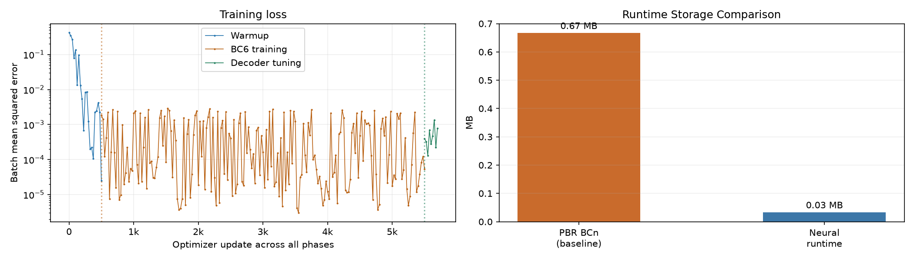
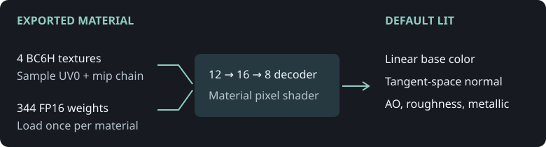
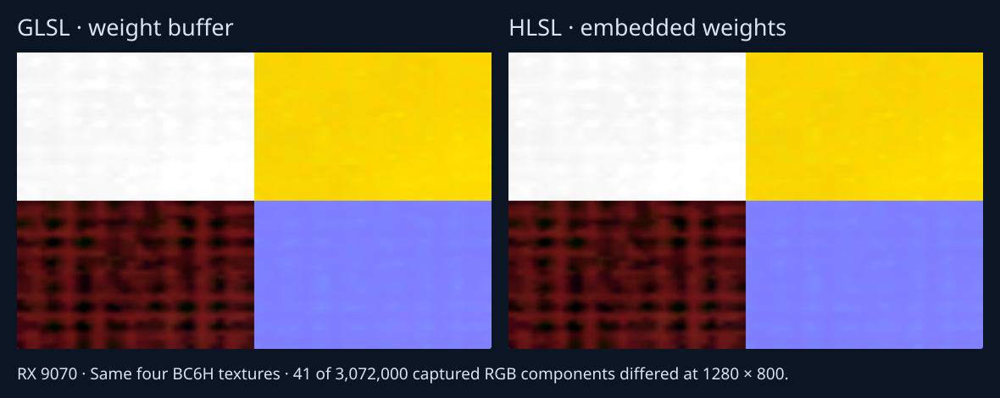

# NN-PBR

PyTorch and Vulkan implementation of [Real-Time Neural Materials using Block-Compressed Features](https://arxiv.org/abs/2311.16121). Each material has four BC6H feature textures and a 688-byte decoder. The fragment shader samples an RGB triplet from each texture and passes the 12 values through a 12 → 16 → 8 MLP to reconstruct albedo RGB, tangent-space normal XY, ambient occlusion, roughness and metallic.

Train in PyTorch or Qt Studio, then use the same export in the Vulkan viewer or the [Unreal Engine 5 runtime plugin](#unreal-engine-5-runtime-plugin).

## Screenshots

| Red plaid · 2048 × 2048 | Hammered copper · 512 × 512 |
| --- | --- |
|  |  |
| [Plaid model and weights](models/red-plaid-2k) | [Copper model and weights](models/hammered-copper-512) |

Both captures use the embedded HLSL decoder on a Radeon RX 9070. The top row of each capture shows AO and packed AO/roughness/metallic (ORM). The bottom row shows albedo and tangent-space normals.

## Results

| | Red plaid | Hammered copper |
| --- | ---: | ---: |
| Training updates (warmup / BC6H / decoder) | 5,000 / 200,000 / 1,000 | 500 / 5,000 / 200 |
| Training time on RX 9070 | 4 h 53 min | 2 min 22 s |
| DDS textures + FP16 weights + metadata | 471,265 bytes | 34,620 bytes |
| Albedo MSE | 0.000249 | 0.000392 |
| Normal XY MSE | 0.194 | 0.00404 |
| ORM MSE | 0.00201 | 0.00456 |

MSE is measured at full resolution from the exported DDS textures and FP16 weights. Albedo uses [0, 1]. Normal XY and ORM use [−1, 1] for training and error measurement. The reference BCn storage estimate for the 2K plaid is 11,184,864 bytes (BC1 albedo, BC5 normals, BC1 ORM, including mips).

### Red plaid

The decoder preserves the plaid checks. Fine weave detail in the normal map accounts for most of the reconstruction error.




[Loss curve (SVG)](docs/figures/red-plaid/training_loss.svg)

### Hammered copper

The short training schedule uses fused Adam. The hammered pattern is visible in the reconstruction, with softer edges on the smallest pits.




[Loss curve (SVG)](docs/figures/hammered-copper/training_loss.svg)

## Building the Vulkan demo

The viewer requires CMake, a C++17 compiler and the Vulkan SDK with `glslc`. The viewer opens the bundled 64 × 64 plaid model by default. Select another material with `--export-dir`. Windows Release build:

```sh
cmake -S . -B build
cmake --build build --config Release
build/Release/vk_neural_demo.exe --export-dir models/hammered-copper-512/export --embedded-hlsl
```

## Unreal Engine 5 runtime plugin

`NNPBRRuntime` is a C++ source plugin targeting UE 5.6 and 5.8 on desktop Windows and Linux. It requires a GPU with unsigned BC6H texture support. Each material instance holds four latent textures with their exported mip chains and 344 decoder weights and biases. The material shader samples UV0, decodes the filtered features, and feeds linear base color, tangent-space normal, AO, roughness and metallic into Unreal’s Default Lit shading model.



**Try hammered copper**

1. Copy [NNPBRRuntime](ue5/NNPBRRuntime) into your C++ project’s `Plugins/` directory. Enable the plugin, build the editor target, then use the `NNPBRCreateMaterial` commandlet once to generate the master material.
2. Copy `metadata.json`, `decoder_fp16.bin` and the four DDS files from the [copper export](models/hammered-copper-512/export) into `Content/NNPBRExports/Copper/`. Keep these as raw files.
3. In a mesh actor’s **BeginPlay**, call **Load Neural Material** with `NNPBRExports/Copper` and leave **Parent Material** empty. Pass the returned instance to **Set Material** on mesh element 0. Loading is synchronous. Meshes using the same copper export can share that instance.

**Verification.** Seven standalone tests passed on Windows, including decoder comparisons on the RX 9070 using the three bundled models. The first Unreal editor build, mesh render and packaged-game test are pending for both engine versions. [UE build commands and packaging settings](ue5/README.md).

## Qt material editor

The Qt app imports albedo, normal, AO, roughness and metallic maps. Select each map individually. The optional CLI folder shortcut expects `albedo.png`, `normal.png`, `ao.png`, `roughness.png` and `metallic.png`. DirectX normal maps with `dx` or `directx` in the filename have their green channel flipped during preparation.

Build the Vulkan viewer as above and install the optional Qt dependency in the same Python environment as PyTorch.

```sh
python -m pip install PySide6-Essentials
python -m nnpbr.studio
```

**Double-clickable Windows build.** From a Windows virtual environment with PyTorch, PySide6-Essentials and the project dependencies installed, use `python packaging/windows/build_studio.py`. The default executable is `%LOCALAPPDATA%\NN-PBR Studio\App\NN-PBR Studio.exe`. Copy the whole `App` folder to move it. It includes Python, the GPU runtime from the build environment, the Vulkan viewer and the copper export. Use `--output` with a fresh directory for another build. Training from the packaged app writes to `%LOCALAPPDATA%\NN-PBR Studio\runs`.

The workspace keeps five source thumbnails beside the preset, progress bar and live loss plot. **Advanced settings** exposes feature sizes, mips, phase lengths, learning rates, batch sizes, seed, checkpoint interval and optimizer settings. Windows source runs write under `runs/studio/`. Linux uses `$XDG_DATA_HOME/nn-pbr-studio/runs`, defaulting to `~/.local/share/nn-pbr-studio/runs`.

Drag the dividers to resize the source list, settings, preview, loss graph, log and optional model inspector. Studio uses Qt Fusion with dark horizontal and vertical scrollbars. **Compile forward** uses PyTorch Inductor by default. On a GPU without Triton it selects `aot_eager`, which captures the graph and executes GPU operations with eager kernels.

Use **Add material…** to enter a name, then choose each PNG with the button beside its channel. Maps can have arbitrary filenames and come from different folders. Click a source row to preview or replace its maps. Check the materials to include, then choose **Train N materials**. Studio trains checked sources in list order using the current settings and writes a separate checkpoint and export for each. Double-click a completed row to inspect its result. The minus button removes the highlighted row from the list. The CLI also accepts repeated `--maps` arguments.

**Open model** loads an existing export for analysis. The overview displays albedo, normals and packed ORM in rows, with the source, decoded result, absolute error and latent previews side by side. Each row reports MSE. Select a channel to inspect its error scale. The source comes from the training reference when available, or from the five selected maps. Without a reference, the decoded material and latent previews remain available.

On native Linux, install a PyTorch build for your GPU and the Vulkan, Qt and GLFW platform dependencies. The standard single-configuration CMake build places the viewer at `build/vk_neural_demo`. Studio also accepts a custom `--viewer` path. Linux GPU performance has yet to be measured for this project. [AMD Radeon Linux compatibility matrix](https://rocm.docs.amd.com/projects/radeon-ryzen/en/latest/docs/compatibility/compatibilityrad/native_linux/native_linux_compatibility.html).

For a Linux applications-menu launcher, use `python packaging/linux/install_studio.py` from the Python environment with PySide6 and PyTorch installed. It builds the viewer and installs a per-user desktop entry for the current checkout and interpreter. Keep both in place while using the launcher.

For Triton on the RX 9070, install the matching PyTorch and Triton wheels from the same ROCm release in the Studio environment. Select **Advanced settings → Compile forward with PyTorch**, or pass `--compile-model` to the trainer. The training log identifies the selected GPU and Triton version when using Inductor. [AMD Linux wheel installation](https://rocm.docs.amd.com/projects/radeon-ryzen/en/latest/docs/install/installrad/native_linux/install-pytorch.html).

To verify the compiler on that machine before a long bake, compile the warmup and BC6 forward passes and compare their outputs and parameter gradients with eager execution:

```sh
python -m nnpbr.check_triton --device cuda:0
```

```sh
cmake -S . -B build -DCMAKE_BUILD_TYPE=Release
cmake --build build --parallel
python -m nnpbr.studio --export-dir models/hammered-copper-512/export
```

**Weights & mips** displays numeric FP16 decoder parameters and individual BC6H mip previews. **Launch Vulkan** opens the standalone viewer with the selected weights and four DDS textures. **Export package** copies the runtime assets. The File menu accepts loose BIN and DDS files. Use `--export-dir` and `--maps` to open a model and source folder from the CLI. For a custom viewer build, pass `--viewer PATH_TO_EXECUTABLE`.

The Vulkan CLI also accepts individual runtime files. Supply the 688-byte decoder blob and four unsigned BC6H DDS pyramids in feature order (0 through 3). This path uses the GLSL buffer decoder and supports files outside an export directory.

```powershell
$export = 'models/hammered-copper-512/export'
build/Release/vk_neural_demo.exe --final-view --weights "$export/decoder_fp16.bin" --latents "$export/latent_00.bc6.dds" "$export/latent_01.bc6.dds" "$export/latent_02.bc6.dds" "$export/latent_03.bc6.dds"
```

## Training

Python 3.12 with PyTorch. Install the PyTorch build for the target GPU before the project dependencies. [AMD Windows installation guide](https://rocm.docs.amd.com/en/latest/install/rocm.html?fam=radeon&gfx=gfx1201&gpu=rx-9070&i=pip&os=windows&w=graphics&windows-ver=11).

```sh
python -m pip install -r requirements.txt
python -m nnpbr smoke                       # 64 × 64 CPU test
python -m nnpbr train red-plaid-bl          # 2048 × 2048 GPU preset
python -m nnpbr check runs/red-plaid-bl/train
python -m nnpbr view models/red-plaid-2k --hlsl
```

The CPU preset uses 150 / 400 / 100 updates. The full GPU preset uses 262,144 samples per update and three phases.

1. **Warmup (5k).** Train unconstrained feature textures and the decoder.
2. **BC6H training (200k).** Fix the partition in each block. Optimize endpoints, texel indices and decoder weights.
3. **Decoder tuning (1k).** Freeze the quantized features. Tune the decoder against the texels the GPU will sample.

Other bundled inputs include `scratched-up-steel-bl` and `worn-rusted-painted-bl`. Both presets accept `--out` for a new output directory and write per-mip scores to `mip_metrics.json`. The lower-level trainer exposes microbatch size, checkpoint resume, fused Adam and the progress display through `python -m nnpbr --help`. [Illustrated BC6H and training guide](docs/tutorial.html).

### Figures

```sh
python -m nnpbr.plot runs/red-plaid-bl/train
python -m nnpbr.figures runs/red-plaid-bl/train --out docs/figures/red-plaid
```

The loss plot uses cumulative optimizer updates across all three phases. The comparison figure uses the original reference and reconstructs the material from the exported files.

## Shader integration

| File in `export/` | Contents |
| --- | --- |
| `latent_00.bc6.dds` … `latent_03.bc6.dds` | Four mipmapped, unsigned BC6H Mode 10 textures |
| `decoder_fp16.bin` | 344 FP16 weights and biases, 688 bytes |
| `metadata.json` | v5 schema, texture dimensions, mip inventory and file hashes |
| `material.hlsl` | Pixel shader include with the decoder weights embedded as constants |

Bind the textures in file order at `t1`–`t4` and a trilinear clamp sampler at `s0`. Call `DecodeNeuralMaterial(uv)` in the pixel shader. For tiled coordinates, pass UV derivatives taken before `frac()` to `DecodeNeuralMaterialWithGrad`. Convert reconstructed albedo from sRGB to linear before lighting.

```sh
python -m nnpbr.hlsl models/red-plaid-2k/export --spirv
python -m nnpbr.validate --export-dir models/red-plaid-2k/export
```

`--spirv` compiles the fragment shader for the Vulkan demo. The embedded path binds only the four latent textures. Older v4 exports require regeneration.



## Codec tests

```sh
cmake -S . -B build -DNNPBR_BUILD_CODEC_TESTS=ON
cmake --build build --config Release
python -m unittest discover -s tests -v
```

Set `BCDEC_ORACLE` to the absolute path of the built `bcdec_oracle` library before the Python tests to include the independent decoder comparison. [Codec verification and RX 9070 readback](docs/tutorial.html#fixes).
