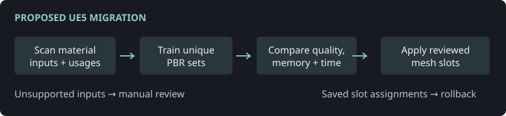

# Project material migration · UE 5.6 proposal

**First milestone:** choose a content folder, list eligible material instances and show the resolved input channels, affected mesh slots and reason for each exclusion. The scan is read-only. Test one representative level before expanding to a project.

| Stage | Implementation | Review criterion |
| --- | --- | --- |
| Inventory | Trace effective material-instance overrides through parent materials. Identify base color, normal XY, AO, roughness and metallic by graph connection or a known master mapping. Count references to each source texture and material. | Every material in scope has a status, reason, source maps or constants, UV channel, sampler addressing and mesh usage. |
| Prepare | First support opaque Default Lit surfaces with square, UV0-aligned maps, compatible mip settings and clamp sampling. Expand packed ORM by actual channel wiring. Handle scalar defaults, sRGB albedo and normal orientation explicitly. Deduplicate equivalent inputs and training settings by content hash. | A technical artist can inspect the five prepared channels before any training. Flag wrap sampling, independent UV transforms, dynamic parameters, opacity, emissive, detail normals, layered graphs, VT, UDIM and non-surface textures for manual review. |
| Train | Send selected sets to the existing external trainer, one decoder per distinct material set. Record source hashes, preset, seed and output directory in a manifest. Queue jobs per GPU with progress, cancellation, checkpoint resume and export verification. | Restarting the queue reuses valid exports. Changing a packed-channel mapping or source file invalidates its result. |
| Compare | Import candidates into a generated content folder. Capture the same UVs, lights, camera and mip distances for source and candidate. Compare normal angular error, albedo and ORM errors, cooked bytes including shared sources, resident GPU memory and GPU frame time in a representative scene. | The artist sets thresholds and reviews the worst cases. Keep a conventional candidate when the neural version loses quality or costs more than the project budget permits. |
| Apply | Preview the replacement list by mesh and material slot. Start with component overrides on selected actors in a test level. Record original and generated asset paths and slot indices. Use an editor transaction for immediate undo and a persistent manifest for rollback after restart. Refuse to overwrite slots edited since the scan. | Save, reopen and cook the level. Verify identical slot coverage. Restore original assignments from the manifest and verify the level again. |

**Pilot set.** Use copper for the end-to-end test, plaid to stress high-frequency normals, two instances sharing textures to test deduplication and storage accounting, and a masked or UV-transformed material to test exclusion. Include one failed training job and one interrupted queue.

**Broader coverage.** Later phases can preserve additional master graphs by replacing only compatible texture-sampling subgraphs and retaining other shading inputs. A tiling material requires wrap-aware training and mip sampling before automatic conversion. UI textures, decals, lightmaps and lookup tables have different semantics and need their own treatment. This proposal does not claim engine-wide texture replacement.
