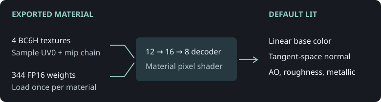

# NN-PBR for Unreal Engine

The source plugin targets desktop UE 5.6 and 5.8 on hardware with unsigned BC6H sampling. The first engine build and render are pending. Each export supplies one mesh material. The runtime reads the model once when requested. Loading is synchronous, so load during setup and reuse the material instance across meshes that share a model.



## First test on UE 5.6

1. Copy the entire `ue5/NNPBRRuntime` folder to `MyGame/Plugins/NNPBRRuntime` in a C++ project. Enable **NN-PBR Runtime** in the project. Close the editor before building.
2. Build the editor target and generate the master material. Substitute the engine path, project path and editor target name in this PowerShell example.

```powershell
$UE = 'D:\Epic\UE_5.6'
$Project = 'D:\Projects\MyGame\MyGame.uproject'
& "$UE\Engine\Build\BatchFiles\Build.bat" MyGameEditor Win64 Development "-Project=$Project" -WaitMutex
if ($LASTEXITCODE -ne 0) { throw 'Editor target failed to build' }
& "$UE\Engine\Binaries\Win64\UnrealEditor-Cmd.exe" $Project -run=NNPBRCreateMaterial -unattended -nop4 -stdout -FullStdOutLogOutput
```

## Import a material before Play (UE 5.6)

1. In the level editor, choose **Tools → Import NN-PBR Material…** and select `models/hammered-copper-512/export/metadata.json`. Leave the BIN and four DDS files beside it. The importer validates the export before creating an asset. On first import it generates the master and placeholder in the plugin’s Content folder if needed.
2. Choose a new material name and destination under `/Game`. The importer saves one ordinary material instance with the BC6H blocks embedded in four texture objects. It retains every exported mip and stores the decoder values as vector parameter overrides.
3. The **NN-PBR Details** window shows four latent previews with dimensions and mip counts. Expand **Hidden Layer** or **Output Layer** to inspect each neuron’s input weights and bias. Select the instance in the Content Browser and choose **Tools → Inspect NN-PBR Material** to reopen it.
4. Drag the saved instance onto a mesh in the level viewport. Save the level, reopen the project, and check the mesh and inspector again. The imported instance can render without the source export folder. Include the instance, level, master and placeholder in source control. The plugin must remain enabled.

## Load loose files at runtime

For runtime model selection, copy the six raw files to `Content/NNPBRExports/Copper`. On a mesh actor’s **BeginPlay**, call **Load Neural Material** with `NNPBRExports/Copper`. Leave **Parent Material** empty to load the generated master. Pass the returned instance to **Set Material** at element 0, or print the node’s **Error** output if loading fails.

Use a UV-mapped plane and Buffer Visualization to inspect Base Color, World Normal, Roughness and Metallic. Move the camera away to exercise the uploaded mip chains. Copper uses latent base sizes 128, 64, 32 and 16. UV0 uses clamp addressing. The decoder converts albedo from sRGB to linear and reconstructs a tangent-space normal. The default `NNNormalYSign` is −1 for OpenGL-style normal sources. Set it to +1 on the instance for sources already in Unreal’s convention.

## Packaged build

For an imported instance, cook the referencing level and its material dependencies. For loose-file loading, include the generated master and stage the raw exports. Add these entries to the project's `Config/DefaultGame.ini`, then cook and package a Development build with the test map included.

```ini
[/Script/UnrealEd.ProjectPackagingSettings]
+DirectoriesToAlwaysCook=(Path="/NNPBRRuntime/Materials")
+DirectoriesToAlwaysStageAsUFS=(Path="NNPBRExports")
```

Launch the packaged game on a BC6H-capable device. Verify copper loads from the relative directory. On a second call, try a missing directory and check the node returns an error. A flat default material, shader compile error or missing mip chain is a failed integration test. For feedback, record the engine version, rendering backend and first build or shader error from the project log.

## Check the saved asset across editor sessions

Use a fresh test package and the copper metadata path. The first process imports through the editor importer. The second process reloads that asset and checks all 344 parameters and the complete DDS bytes of all four textures against the original export.

```powershell
$Cmd = "$UE\Engine\Binaries\Win64\UnrealEditor-Cmd.exe"
$Meta = 'D:\NN-PBR\models\hammered-copper-512\export\metadata.json'
$ArgsNN = @($Project, '-run=NNPBRImportCheck', "-Metadata=`"$Meta`"", '-Package=/Game/NNPBRTest/MI_Copper', '-unattended', '-stdout')
& $Cmd @ArgsNN
if ($LASTEXITCODE -ne 0) { throw 'Import failed' }
& $Cmd @ArgsNN -Verify
if ($LASTEXITCODE -ne 0) { throw 'Reload check failed' }
```

## Standalone checks

From the repo root with CMake, a C++17 compiler and the Vulkan SDK available:

```sh
cmake -S ue5/tests -B build/ue-checks
cmake --build build/ue-checks --config Release
ctest --test-dir build/ue-checks -C Release --output-on-failure
```

The tests parse the shipped DDS and decoder files, validate the compiled shader, and compare its Vulkan output with a CPU reference using 64 synthetic latent vectors per model. Those checks cover the decoder math. The UE build, material graph, texture filtering and cooked file staging need the engine test above.
